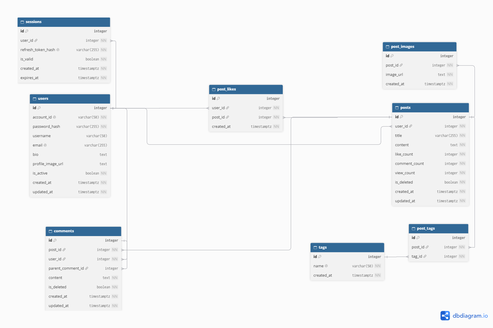

# ERD 상세

> Agent-CS 컴퓨터공학과 커뮤니티 서비스의 데이터베이스 구조를 설명하는 문서  
> PostgreSQL 및 SQLAlchemy ORM 기준으로 **8개 테이블, 총 48개 컬럼** 사용

## 1. User - 사용자 계정 정보 (`users`)

| 필드 | 의미 | 사용 목적 |
| --- | --- | --- |
| id | PK, 사용자 고유 ID | 다른 테이블의 FK 참조 및 사용자 식별 |
| account_id | 로그인용 고유 계정 ID, UNIQUE, NOT NULL | 회원가입 및 로그인, 작성자 계정 표시. 가입 후 변경 불가 |
| password_hash | 해시 처리된 비밀번호, NOT NULL | 로그인 인증. 원문 비밀번호를 저장하지 않음 |
| username | 닉네임, NULL 허용, 중복 허용 | 프로필 및 게시글·댓글 작성자 표시 |
| email | 이메일, UNIQUE, NULL 허용 | 사용자 연락처 및 프로필 정보. 입력된 이메일의 중복 방지 |
| bio | 자기소개, NULL 허용 | 사용자 프로필 소개 |
| profile_image_url | 프로필 이미지 URL, NULL 허용 | 프로필 및 작성자 이미지 표시 |
| is_active | 계정 활성 상태, 기본값 `true` | 회원 탈퇴 시 `false`로 변경하여 기존 게시글·댓글과의 연결 유지 |
| created_at / updated_at | 계정 생성 및 마지막 수정 시각 | 가입일 표시 및 프로필 수정 시각 관리 |

- **사용 시나리오**:
    - 회원가입, 로그인, 회원 탈퇴, 본인 및 다른 사용자의 프로필 조회·수정
    - 게시글과 댓글의 작성자 정보 표시
    - 특정 사용자의 게시글 및 좋아요한 게시글 목록 조회

## 2. Session - JWT 기반 세션 관리 (`sessions`)

| 필드 | 의미 | 사용 목적 |
| --- | --- | --- |
| id | PK, 세션 고유 ID | 세션 기록 식별 |
| user_id | FK → `users.id`, NOT NULL | 세션 소유자 연결 |
| refresh_token_hash | 리프레시 토큰의 해시, UNIQUE, NOT NULL | 토큰 원문을 저장하지 않고 갱신 요청 시 검증 |
| is_valid | 세션 유효 여부, 기본값 `true` | 로그아웃, 회원 탈퇴 및 새 로그인 시 기존 세션 무효화 |
| created_at | 세션 생성 시각 | 로그인 세션 생성 이력 기록 |
| expires_at | 세션 만료 시각 | 리프레시 토큰 만료 여부 확인 |

- **사용 시나리오**:
    - 로그인 시 리프레시 토큰 해시와 세션 정보 저장
    - 로그아웃 시 해당 세션 무효화, 회원 탈퇴 시 모든 세션 무효화
    - 리프레시 토큰 검증 후 액세스 토큰 갱신
    - **단일 세션 정책**: 새 로그인 시 이전 유효 세션을 무효화하고, 과거 세션 행은 보존

## 3. Post - 게시글 (`posts`)

| 필드 | 의미 | 사용 목적 |
| --- | --- | --- |
| id | PK, 게시글 고유 ID | 게시글 식별 및 다른 테이블의 FK 참조 |
| user_id | FK → `users.id`, NOT NULL | 게시글 작성자 연결 |
| title | 게시글 제목, NOT NULL | 게시글 목록·상세 화면 표시 및 제목 검색 |
| content | 게시글 본문, TEXT, NOT NULL | Markdown 형식의 글과 코드 블록 저장·표시 |
| like_count | 게시글 좋아요 수, 기본값 `0` | 좋아요 개수 표시 |
| comment_count | 게시글 댓글 수, 기본값 `0` | 댓글·대댓글 개수 표시 |
| view_count | 게시글 조회 수, 기본값 `0` | 조회 수 표시 및 조회 수 내림차순 정렬 |
| is_deleted | 게시글 삭제 여부, 기본값 `false` | Soft Delete 처리 및 일반 목록에서 삭제 글 제외 |
| created_at / updated_at | 게시글 생성 및 마지막 수정 시각 | 작성·수정 시각 표시 |

- **사용 시나리오**:
    - 게시글 작성·조회·수정·삭제 및 제목·태그별 검색
    - Markdown 코드 블록과 이미지가 포함된 게시글 표시
    - 조회 수 기준 정렬, 좋아요 및 댓글 수 표시
    - 게시글 삭제 시 데이터의 물리적 삭제 대신 `is_deleted` 값 변경

## 4. PostImage - 게시글 이미지 (`post_images`)

| 필드 | 의미 | 사용 목적 |
| --- | --- | --- |
| id | PK, 이미지 고유 ID | 이미지 레코드 식별 |
| post_id | FK → `posts.id`, NOT NULL | 이미지가 속한 게시글 연결 |
| image_url | 이미지 URL, NOT NULL | 업로드된 이미지의 저장 위치 참조 및 본문 이미지 표시 |
| created_at | 이미지 등록 시각 | 이미지 등록 시점 기록 |

- **사용 시나리오**:
    - 게시글 작성·수정 시 업로드한 이미지의 URL 관리
    - Markdown 본문의 이미지 참조와 실제 저장된 이미지 URL 연결
    - 동일 게시글에 동일한 `image_url`이 중복 등록되지 않도록 `UNIQUE(post_id, image_url)` 적용

## 5. PostLike - 게시글 좋아요 (`post_likes`)

| 필드 | 의미 | 사용 목적 |
| --- | --- | --- |
| id | PK, 좋아요 기록 고유 ID | 좋아요 기록 식별 |
| user_id | FK → `users.id`, NOT NULL | 좋아요를 누른 사용자 식별 |
| post_id | FK → `posts.id`, NOT NULL | 좋아요 대상 게시글 식별 |
| created_at | 좋아요 생성 시각 | 좋아요 등록 시점 기록 및 정렬 |

- **사용 시나리오**:
    - 게시글 좋아요 등록·취소
    - 특정 사용자가 좋아요한 게시글 목록 조회
    - `UNIQUE(user_id, post_id)`로 한 사용자의 동일 게시글 중복 좋아요 방지
    - 좋아요 등록·취소 시 `posts.like_count`와 실제 기록의 일관성 유지

## 6. Comment - 댓글 및 대댓글 (`comments`)

| 필드 | 의미 | 사용 목적 |
| --- | --- | --- |
| id | PK, 댓글 고유 ID | 댓글 식별 및 대댓글의 상위 댓글 참조 |
| post_id | FK → `posts.id`, NOT NULL | 댓글이 속한 게시글 연결 |
| user_id | FK → `users.id`, NOT NULL | 댓글 작성자 연결 |
| parent_comment_id | FK → `comments.id`, NULL 허용 | 최상위 댓글은 `NULL`, 대댓글은 상위 댓글 ID 저장 |
| content | 댓글 본문, TEXT, NOT NULL | 댓글 및 대댓글 내용 표시 |
| is_deleted | 댓글 삭제 여부, 기본값 `false` | 소프트 삭제 처리 |
| created_at / updated_at | 댓글 생성 및 마지막 수정 시각 | 작성·수정 시각 표시 |

- **사용 시나리오**:
    - 게시글의 댓글 목록 조회 및 댓글 작성·수정·삭제
    - `parent_comment_id`를 이용한 대댓글 작성 및 계층형 목록 반환
    - **댓글과 대댓글의 2단계 구조**만 허용하며, 대댓글의 대댓글은 API 로직에서 제한
    - 댓글 삭제 시 `is_deleted`를 변경하고, 게시글의 댓글 수를 정책에 맞게 갱신

## 7. Tag - 게시글 태그 (`tags`)

| 필드 | 의미 | 사용 목적 |
| --- | --- | --- |
| id | PK, 태그 고유 ID | 태그 식별 및 게시글-태그 연결 |
| name | 태그 이름, VARCHAR(50), NOT NULL | 게시글 주제 분류 및 태그 검색 |
| created_at | 태그 생성 시각 | 태그 최초 등록 시점 기록 |

- **사용 시나리오**:
    - `python`, `sql`, `운영체제` 등 게시글 분류용 태그 관리
    - 게시글 작성 시 태그 연결, 태그별 게시글 조회
    - `lower(name)`에 대한 **UNIQUE 인덱스 `uq_tags_name_lower`**로 `Python`, `python`, `PYTHON`의 중복 등록 방지
    - API에서는 태그 입력값에 `strip().lower()`를 적용해 소문자 형태로 정규화하여 저장·검색

## 8. PostTag - 게시글과 태그의 연결 (`post_tags`)

| 필드 | 의미 | 사용 목적 |
| --- | --- | --- |
| id | PK, 게시글-태그 연결 고유 ID | 연결 기록 식별 |
| post_id | FK → `posts.id`, NOT NULL | 태그가 연결된 게시글 식별 |
| tag_id | FK → `tags.id`, NOT NULL | 게시글에 연결된 태그 식별 |

- **사용 시나리오**:
    - 하나의 게시글에 여러 태그 연결 및 하나의 태그를 여러 게시글에서 재사용하는 N:M 관계 구현
    - 게시글의 태그 목록 조회 및 특정 태그를 가진 게시글 검색
    - `UNIQUE(post_id, tag_id)`로 동일 게시글에 같은 태그가 중복 연결되는 것 방지

---

## 테이블 관계 요약

| 관계 | 형태 | 연결 기준 |
| --- | --- | --- |
| User → Session | 1:N | `sessions.user_id` |
| User → Post | 1:N | `posts.user_id` |
| User → PostLike | 1:N | `post_likes.user_id` |
| User → Comment | 1:N | `comments.user_id` |
| Post → PostImage | 1:N | `post_images.post_id` |
| Post → PostLike | 1:N | `post_likes.post_id` |
| Post → Comment | 1:N | `comments.post_id` |
| Comment → Comment | 1:N (자기 참조) | `comments.parent_comment_id` |
| Post → PostTag | 1:N | `post_tags.post_id` |
| Tag → PostTag | 1:N | `post_tags.tag_id` |
| Post ↔ Tag | N:M | `post_tags`를 통한 연결 |

> **설계 참고**: `posts.like_count`, `posts.comment_count`는 집계 값을 저장하는 컬럼으로, 실제 좋아요·댓글 데이터와의 일관성은 API의 트랜잭션 로직에서 관리합니다. `updated_at`은 DB 기본값으로 생성 시각이 설정되며, 수정 시각의 갱신은 애플리케이션에서 처리해야 합니다. 단일 세션 정책과 댓글 2단계 제한도 DB 제약조건만으로 자동 보장되는 것이 아니라 API 로직에서 구현해야 합니다.
